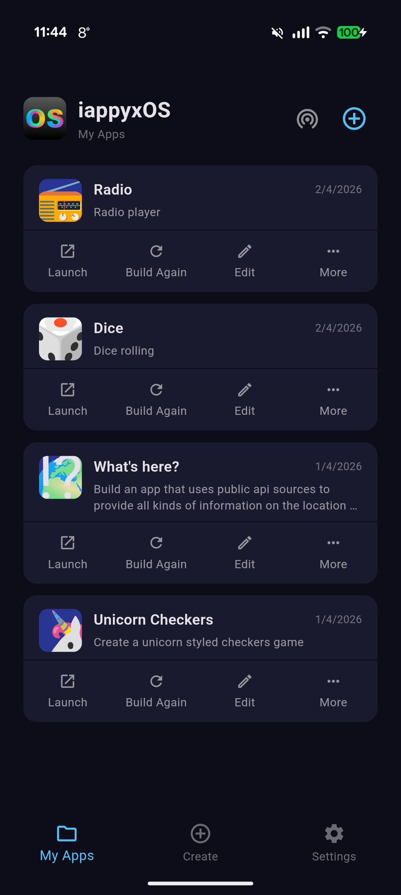
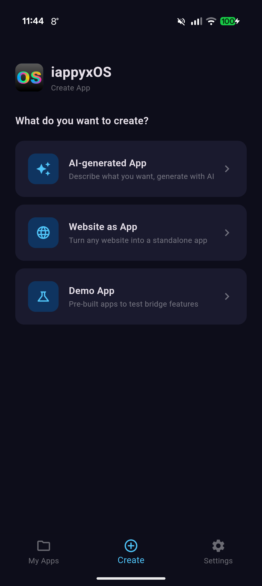
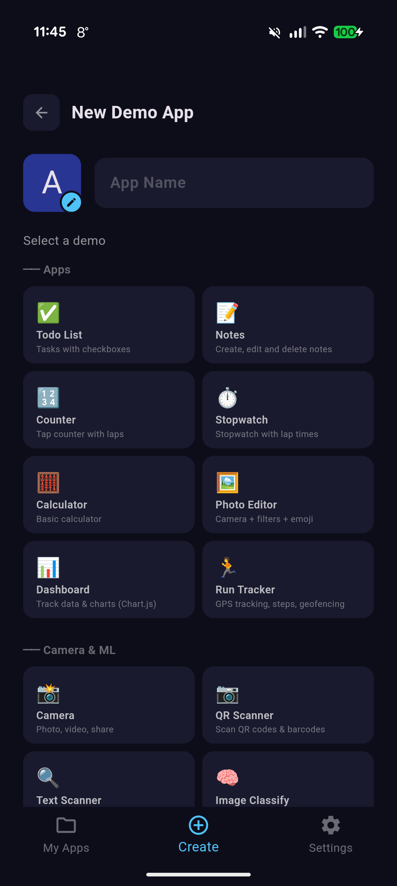
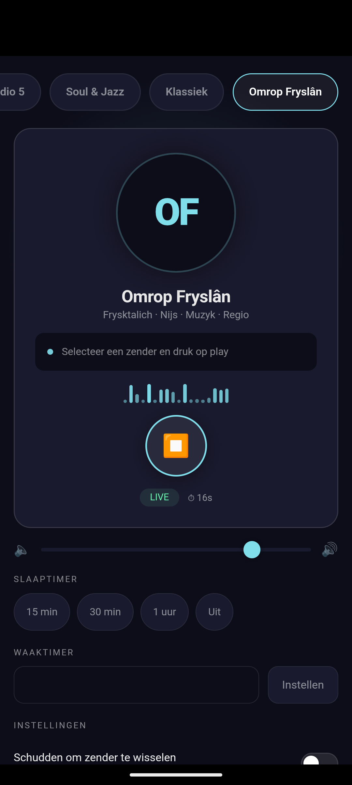
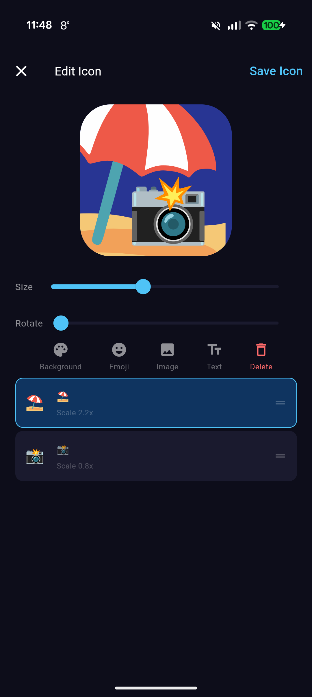
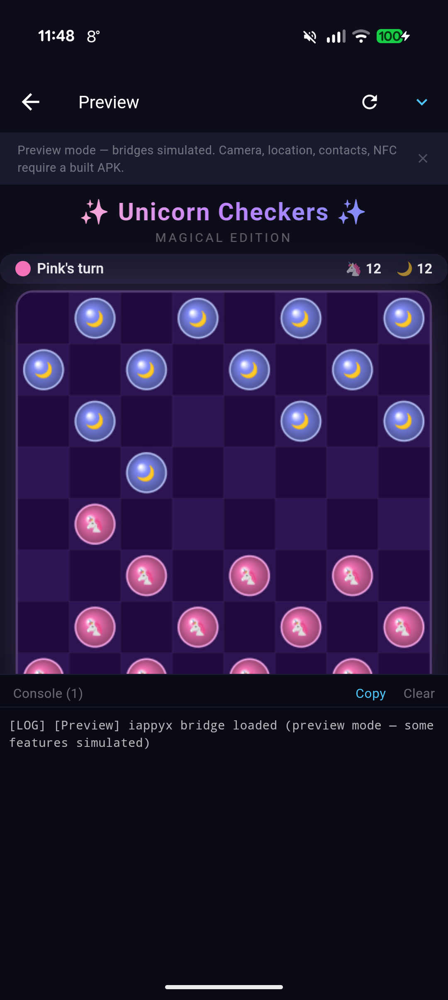

# Applix

[](https://github.com/Konprostart/Applix/releases/latest)

**Generate real Android apps on your device — no server, no app store, no code.**

Describe what you want to your favorite AI, and Applix turns it into a real installed APK with its own launcher icon. Building, signing, and installing all happen on-device. No cloud. No subscription. No coding required.

Derived from [iappyxOS](https://github.com/iappyx/iappyxOS) (MIT licensed). See [NOTICE.md](NOTICE.md) for attribution.

## Screenshots

<p align="center">
  
  
  
  
</p>
<p align="center">
  
  
</p>

*Screenshots from the pre-rebrand build — UI and features are unchanged.*

*My Apps • Create • Demos • Generated Radio App • Icon Editor • Preview with Console*

## What it does

- **AI-generated App** — describe your app in plain language, let an AI generate the code, preview it, and build
- **Website as App** — turn any website into a lightweight standalone app (1MB, no bridges, sandboxed)
- **Demo Apps** — 59 pre-built apps to test native bridges (camera, GPS, NFC, BLE, SSH, network shares, and more)

Every generated app is a real signed APK that appears in your Android launcher. You can share it, uninstall it, or update it — just like any app. Generated apps pass Google Play Protect scanning.

## How it works

```
┌─────────────────────────────────────┐
│         STANDARD LAUNCHER           │
│   App 1 🎯   App 2 📍   App 3 📷   │
└──────────────┬──────────────────────┘
               │ real installed APKs
┌──────────────▼──────────────────────┐
│         GENERATED APP SHELL         │
│  WebView + native bridge layer      │
│  HTML/JS injected as assets         │
└──────────────┬──────────────────────┘
               │ created and signed by
┌──────────────▼──────────────────────┐
│       CONTAINER APP (Applix)      │
│  AI prompt → HTML → APK injection   │
│  → manifest patching → v2 signing   │
│  → PackageInstaller                 │
└─────────────────────────────────────┘
```

1. User describes an app (or picks a template, or enters a URL)
2. HTML/JS is injected into a pre-built WebView shell APK
3. The Android manifest is binary-patched with a unique package name
4. The APK is signed on-device using the Android Keystore (hardware-backed)
5. The system installer dialog appears — the app shows up in the launcher

## Features

- **AI generation** — automatic via API (Anthropic, OpenRouter, or any OpenAI-compatible local server) or manual copy-paste to any AI
- **Bridge validation** — generated code is checked against the bridge reference; unknown calls are flagged and repaired once automatically in the API flow
- **37 native bridge classes (140+ methods)** — camera, location, sensors, audio, notifications, push notifications (FCM), NFC, Bluetooth LE, Bluetooth Classic (serial), SSH/SFTP, SMB network shares, HTTP server/client, TCP/UDP sockets, WiFi Direct, mDNS, biometric, SQLite, contacts, SMS, calendar, clipboard, TTS, screen, vibration, alarms, media gallery, download manager, home screen widgets, scheduled background tasks, event triggers (charger / headphones / Bluetooth / WiFi / Android Auto), app-launch intents, and more
- **Bundled app files** — attach databases, JSON, images, or any data file to your app at build time. Accessible at runtime via `readAsset()` / `extractAsset()` — no download needed
- **Icon editor** — emoji, text, images, custom colors, gradients, shadows, filters, rotation, multiple layers
- **App management** — launch, rebuild, edit, share (APK, HTML, QR code, WiFi Direct), uninstall
- **QR code transfer** — share apps between devices via animated QR codes (no internet needed)
- **P2P sharing** — share built apps directly between devices via WiFi Direct
- **CSS style presets** — Material, Glassmorphic, Minimal, Dynamic (Material You colors) — applied globally
- **Preview** — test your app in a WebView with live JS console and simulated bridges before building
- **Offline-first** — everything except AI generation works in airplane mode
- **Configurable** — custom system prompt, app ID prefix, multiple AI providers, CSS styles
- **[Showcase](https://github.com/Konprostart/Applix-showcase)** — browse and build community apps directly in the app, or submit your own via PR
- **Home screen widgets** — generated apps can create configurable widgets with grids, clocks, timers, toggles
- **Background tasks** — scheduled JS execution even when the app is closed, auto-updates widgets
- **Version history** — automatic snapshots on rebuild, restore previous versions
- **Onboarding** — guided first-launch experience

## Quick start

1. [Download the latest Beta](https://github.com/Konprostart/Applix/releases)
2. Sideload on Android 10+ (enable "Install unknown apps" for your browser)
3. Open Applix → Create → pick a mode → build

**AI generation (two options):**
- **Manual (recommended)** — copy the generated prompt, paste it into any AI chat (Claude, ChatGPT, Gemini, etc.), paste the HTML back, preview, build. The Manual flow offers two prompt variants:
  - **Full (~45 KB)** — works with any AI, no internet needed on the AI's side.
  - **Linked (~600 chars)** — tiny prompt that points the AI at [`SPEC.md`](SPEC.md) via its canonical raw URL. Works with AIs that can fetch URLs (Claude.ai, ChatGPT with browsing, Gemini). Useful when your AI's paste limit rejects the full prompt.
- **Automatic** — add your API key in Settings (Anthropic or OpenRouter), then tap "Generate" in the Create flow
- **Local / self-hosted** — Settings → Custom: point at any OpenAI-compatible server (Ollama, LM Studio, vLLM). Enter the server URL (`http://<lan-ip>:11434/v1`), tap refresh, pick a model. API key is optional; cleartext HTTP on your LAN is supported

### Using the spec from any AI tool
`SPEC.md` at the repo root is the canonical Applix bridge reference, always fetchable at:
```
https://raw.githubusercontent.com/Konprostart/Applix/main/SPEC.md
```
If you're chatting with Claude.ai or ChatGPT directly (outside the container), include that URL in your prompt and the AI will fetch it. When you get the HTML back, import it via Create → paste HTML.

## Sharing apps

Share your generated apps with others — multiple ways, no account needed:

- **Share APK** — send the compiled app file via any app (WhatsApp, email, Drive, Bluetooth)
- **Share Nearby** — transfer directly to another device via WiFi Direct, no internet required
- **Share via QR** — beam your app to another device using animated QR codes — no WiFi, no Bluetooth, just two screens
- **Share HTML** — export the source code so others can preview, modify, and rebuild it in their own Applix

Recipients with Applix installed can rebuild shared apps with their own icon and name.

## Showcase

[Applix Showcase](https://github.com/Konprostart/Applix-showcase) is a public collection of apps
built with Applix. Browse them in the app: **Create → Showcase**, pick an app, and it installs
like any other app - your own icon, your own name.

Submitting your own app takes one tap: **My Apps → menu → Submit to Showcase**, enter a GitHub
token, and Applix opens a pull request for you. The index is rebuilt automatically when the
pull request is merged, so a new app shows up in the app without anyone touching a file.

## Native bridges

Generated apps access device hardware through a JavaScript bridge (`window.iappyx`):

| Bridge | What it does |
|--------|-------------|
| Storage | Key-value, file storage, pick files, save to Downloads, share files, move/copy with content URI support |
| Camera | Photo, video, QR/barcode scan, OCR, ML image classification, background removal, EXIF metadata, real-time frame scanning |
| Location | GPS single shot, continuous tracking, foreground service, geofencing |
| Sensors | Accelerometer, gyroscope, magnetometer, compass heading, proximity, light, pressure, step counter |
| Audio | Play/pause/seek/loop, record, speech-to-text, media session (lock screen controls), sound effects, audio focus, audio visualizer (waveform + FFT) |
| Notifications | Send with actions, schedule, repeating, badge count, cancel |
| NFC | Read tags, write NDEF text/URI |
| Bluetooth LE | Scan, connect, read/write characteristics, subscribe to notifications |
| SQLite | Full SQL database with transactions |
| Biometric | Fingerprint/face authentication |
| TTS | Text-to-speech with language, pitch, rate, completion callback |
| Contacts | Read device contacts (name, phone, email) |
| SMS | Send SMS messages |
| Calendar | Read/add calendar events |
| Clipboard | Read/write, monitor changes |
| Screen | Keep on, brightness, wake lock |
| Vibration | Patterns, haptic feedback (click, tick, heavy) |
| Alarms | Exact and repeating alarms (fire even when app is closed) |
| Share | Photos, text, files via share sheet; receive shared content from other apps |
| Device | Info, connectivity, torch, print, wallpaper, DND, shortcuts, dark mode, Material You theme colors |
| Media | Browse gallery (photos/videos/music), pick images, save to gallery, get metadata |
| Download | Queue file downloads with progress, survives app close |
| HTTP Server | Local HTTP/HTTPS server with TLS, CORS, file streaming |
| HTTP Client | Native requests with self-signed cert support, multipart upload, cookies (OkHttp) |
| SSH / SFTP | Remote terminal, command execution, file transfer, port forwarding (JSch) |
| SMB | Browse Windows/NAS network shares, upload, download, copy, rename, delete (jcifs-ng) |
| TCP Socket | Persistent bidirectional connections with TLS support |
| UDP | Datagram send/receive, unicast and multicast |
| NSD (mDNS) | Service registration, discovery, and resolve |
| WiFi Direct | P2P peer discovery, connection, group management |
| Push Notifications | FCM push notifications (requires Firebase setup in Advanced Settings) |
| Bluetooth Classic | Serial communication (SPP) for Arduino, ESP32, OBD-II car diagnostics, HC-05/HC-06 |
| Widget | Home screen widgets with configurable grid layouts, clocks, timers, checkboxes, toggles |
| Tasks | Scheduled background JS execution — fetch APIs, update widgets, send notifications while app is closed |
| Triggers | Fire a JS callback when charger / headphones / Bluetooth / WiFi / Android Auto connects or disconnects. Optional persistent mode survives app swipe-away and reboot. |
| Intent | Launch other installed apps (by package) or deep-link URIs. Enumerate installed apps for pickers. |
| Capabilities | Query available bridges and permissions at runtime |

## Building from source

### Prerequisites
- Android SDK
- Flutter 3.x
- Java 17+

### Quick build
```bash
./build.sh
# Output: bin/Applix.apk (auto-installs if device connected)
```

### Manual build
```bash
# Shell APK (the template injected into generated apps):
cd src/shell_apk && ./gradlew assembleRelease
cp app/build/outputs/apk/release/app-release.apk ../container_app/assets/shell_template.apk

# Container app (Applix itself):
cd src/container_app && flutter pub get && flutter build apk --release
```

> **Note:** Release builds require a signing keystore. Without `key.properties`, the build falls back to debug signing. See [Signing](#signing) below.

### Signing

The release APK is signed with a private keystore (not in this repo). To set up your own:

```bash
keytool -genkey -v -keystore applix-release.p12 -storetype PKCS12 -keyalg RSA -keysize 2048 -validity 10000 -alias applix
```

Create `src/container_app/key.properties`:
```
storePassword=YOUR_PASSWORD
keyPassword=YOUR_PASSWORD
keyAlias=applix
storeType=PKCS12
storeFile=../../applix-release.p12
```

Both files are gitignored. Never commit your keystore or passwords.

Official releases are signed in CI with a key stored in GitHub Actions secrets. See
[docs/RELEASING.md](docs/RELEASING.md) for the release procedure and the required secrets.

## Releases

Pre-built APKs are published on every `v*` tag: the signed container app plus the full and web
shell templates. Latest release: https://github.com/Konprostart/Applix/releases/latest

The version of the project lives in the `VERSION` file at the repo root (`0.1.0+1` = version
`0.1.0`, build `1`). `python3 tools/sync_version.py` propagates it to `pubspec.yaml`, both shell
templates and `lib/version.dart`; CI fails if anything drifts. The changelog lives in
[CHANGELOG.md](CHANGELOG.md) and is validated by CI on every push.

## FAQ

See [FAQ.md](FAQ.md) for answers to common questions — including the hard ones like "isn't this just a WebView wrapper?" and "why is it called OS?"

## License

MIT — see [LICENSE](LICENSE). Original work Copyright (c) 2026 iappyx (iappyxOS), used under the MIT License.

## Brand assets

Editable logo (SVG) and PNG previews live in [`docs/brand/`](docs/brand/). `python3 tools/gen_icons.py --apply` regenerates the Android launcher mipmaps from the same mark.

## Attribution

Applix is an independent derivative of **iappyxOS** by iappyx, used under the MIT License. Original project: https://github.com/iappyx/iappyxOS. See [NOTICE.md](NOTICE.md).

MIT

THE SOFTWARE IS PROVIDED "AS IS", WITHOUT WARRANTY OF ANY KIND, EXPRESS OR IMPLIED, INCLUDING BUT NOT LIMITED TO THE WARRANTIES OF MERCHANTABILITY, FITNESS FOR A PARTICULAR PURPOSE AND NONINFRINGEMENT. IN NO EVENT SHALL THE AUTHORS OR COPYRIGHT HOLDERS BE LIABLE FOR ANY CLAIM, DAMAGES OR OTHER LIABILITY, WHETHER IN AN ACTION OF CONTRACT, TORT OR OTHERWISE, ARISING FROM, OUT OF OR IN CONNECTION WITH THE SOFTWARE OR THE USE OR OTHER DEALINGS IN THE SOFTWARE.

## Support

If you find Applix useful, star the repo and share your generated apps: https://github.com/Konprostart/Applix
